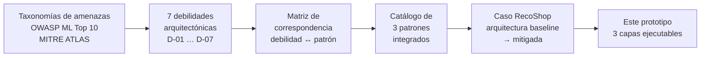
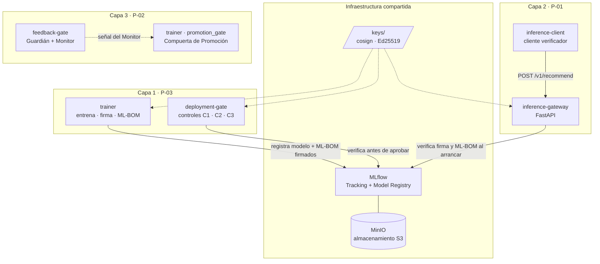
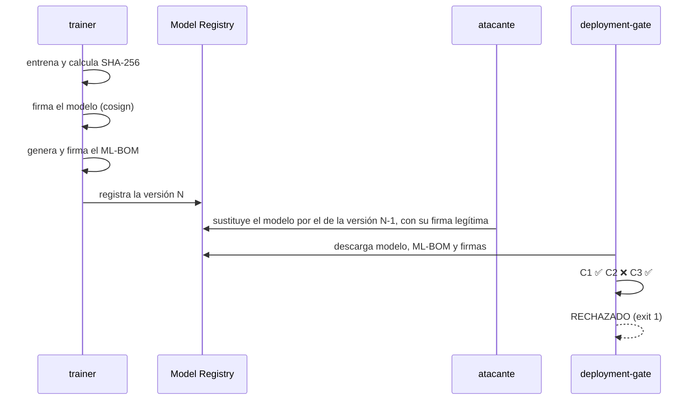
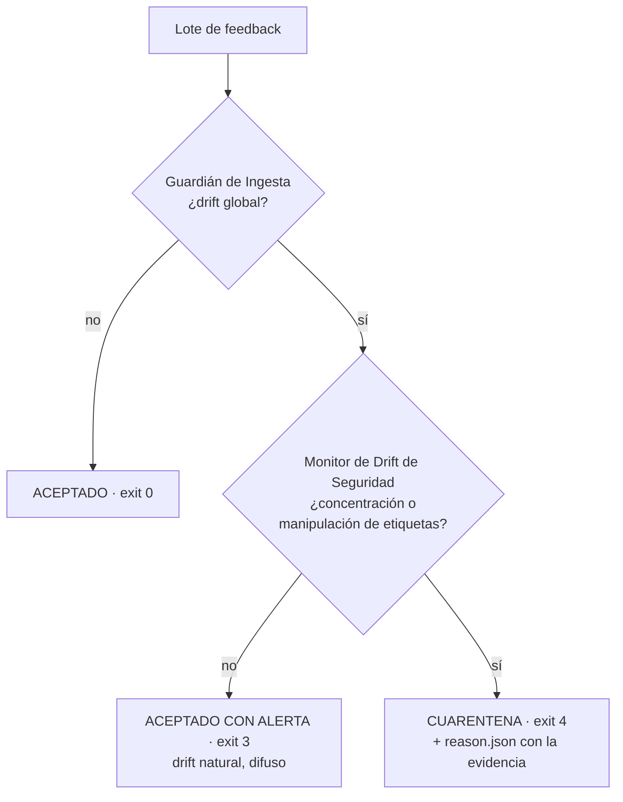

<div align="center">

# RecoShop · Seguridad por diseño para sistemas de Machine Learning

**Prototipo ejecutable de tres patrones de seguridad arquitectónica para MLOps,
validado con evidencia reproducible.**


-F47B20)


</div>

---

## El problema

La seguridad de los sistemas de Machine Learning suele llegar tarde: se parcha
en producción, cuando el modelo ya está desplegado. Las amenazas están bien
catalogadas —[OWASP ML Top 10](https://owasp.org/www-project-machine-learning-security-top-10/)
y [MITRE ATLAS](https://atlas.mitre.org/) las describen con detalle—, pero
están escritas desde la perspectiva del **atacante**: qué técnica usa, qué
activo compromete. Al arquitecto, que diseña el sistema antes de que exista,
esa descripción no le dice qué decisión estructural tomar.

Este proyecto propone el giro contrario: **traducir las amenazas en
debilidades de la propia arquitectura** y mitigarlas con **patrones de
seguridad** aplicables desde el diseño. Y, para que la propuesta no se quede en
papel, la implementa y la pone a prueba.

## El método



Las amenazas se reformulan como **siete debilidades arquitectónicas**, cada una
localizable en un componente concreto de una arquitectura MLOps:

| | Debilidad |
|---|---|
| **D-01** | Confianza implícita en la integridad de artefactos del Model Registry |
| **D-02** | Exposición incontrolada de información en el endpoint de inferencia |
| **D-03** | Canal de retroalimentación no validado en el pipeline de reentrenamiento continuo |
| **D-04** | Ausencia de una capa de validación y sanitización en la entrada de inferencia |
| **D-05** | Canal de comunicación y salida no asegurados (*output integrity*) |
| **D-06** | Confianza implícita en modelos preentrenados de fuentes externas |
| **D-07** | Ausencia de controles de integridad y procedencia en la ingesta de datos de entrenamiento |

Tres patrones integrados cubren las siete:

| Patrón | Qué hace | Debilidades |
|---|---|---|
| **P-01** Secure Inference Gateway | Valida lo que entra al modelo, controla lo que sale y firma cada respuesta | D-02, D-04, D-05 |
| **P-02** Secure Retraining Gate | Distingue el drift natural de la manipulación adversarial antes de reentrenar | D-03 (y la variante de feedback de D-07) |
| **P-03** Trusted ML Artifact Pipeline | Garantiza la procedencia e integridad de datos, modelos base y artefactos | D-01, D-06, D-07 |

## El caso: RecoShop

**RecoShop** es un sistema ficticio de recomendación de productos para
comercio electrónico: un ranker **LightGBM** (`LGBMRanker`, objetivo
*lambdarank*) que ordena los productos candidatos de cada sesión de
navegación. Fue diseñado deliberadamente para que las siete debilidades estén
presentes a la vez: tiene pipeline de entrenamiento, registro de modelos,
endpoint de inferencia y ciclo de retroalimentación. Es un caso de
**demostración**, no de prevalencia: su propósito es mostrar que el método se
aplica de extremo a extremo.

---

## El prototipo

Un único stack de Docker Compose. Las tres capas comparten infraestructura:
almacenamiento S3 (MinIO), Model Registry (MLflow) y claves criptográficas.



### Capa 1 · P-03 Trusted ML Artifact Pipeline

**Debilidad:** D-01. Si el Model Registry confía en que lo que guarda es lo
que se entrenó, quien comprometa el almacenamiento puede sustituir el modelo
en producción sin que nadie lo note.

**Qué hace el prototipo:**

1. El `trainer` entrena el modelo y calcula el SHA-256 del artefacto y del
   dataset de entrenamiento.
2. **Firma el modelo antes de registrarlo** (cosign). El orden es
   intencional: un atacante que comprometa el registry, pero no la clave,
   no puede producir una firma válida.
3. Genera un **ML-BOM** en [CycloneDX 1.7](https://cyclonedx.org/) (estándar
   ECMA-424) —el documento de enlace que el patrón prescribe— que declara el
   modelo con su hash y su *model card*, el dataset con su hash y las
   dependencias con sus versiones. El ML-BOM también se firma.
4. Registra una **versión nueva** en MLflow en cada ejecución: el registry
   funciona como un registro *append-only*.
5. El `deployment-gate` descarga todo del registry —sin confiar en archivos
   locales— y aplica tres controles independientes:

| Control | Pregunta que responde |
|---|---|
| **C1** Firma del ML-BOM | ¿El documento de enlace es auténtico? |
| **C2** Vínculo ML-BOM ↔ modelo | ¿Este modelo es el que la versión declara? |
| **C3** Firma del modelo | ¿El artefacto es auténtico? |



Tres escenarios, tres resultados:

| Escenario | C1 | C2 | C3 | Decisión |
|---|:---:|:---:|:---:|---|
| Modelo íntegro | ✅ | ✅ | ✅ | **Aprobado** |
| Bytes del modelo alterados en el registry | ✅ | ❌ | ❌ | **Rechazado** |
| Modelo sustituido por otro **legítimamente firmado** | ✅ | ❌ | ✅ | **Rechazado** |

El tercer escenario es el más revelador. La firma del modelo es **válida**:
es un modelo auténtico de una versión anterior, ligeramente peor
(NDCG@10 de 0.8796 frente a 0.8818). Un gate que solo verificara firmas lo
aprobaría. Lo detiene el vínculo con el ML-BOM firmado, que declara
exactamente qué artefacto corresponde a cada versión.

### Capa 2 · P-01 Secure Inference Gateway

**Debilidades:** D-02, D-04 y D-05. Un endpoint de inferencia sin controles
acepta cualquier entrada, expone más información de la necesaria y entrega
respuestas que nadie puede verificar.

Un gateway **FastAPI** con tres sub-componentes coordinados:

- **Input Validator** — esquema [Pandera](https://pandera.readthedocs.io/)
  con tipos y rangos por feature (por ejemplo, `price` en (0, 10000),
  `product_popularity` en [0, 1]), además de un chequeo explícito de valores
  no finitos. Una entrada inválida recibe un **422 con cada violación
  enumerada**, no un error opaco.
- **Output Controller** — devuelve solo `product_id` y posición del
  *top-k*, **sin scores crudos** (que facilitarían la extracción del modelo),
  y limita la tasa por cliente con un *token bucket*.
- **Response Signer** — firma cada respuesta con **Ed25519** sobre su JSON
  canónico, para que el cliente detecte cualquier manipulación en tránsito.

Los tres sub-componentes **comparten un registro de sospecha por cliente**
(endurecimiento cruzado). Cada entrada rechazada suma 0.3 y cada exceso de
tasa 0.6, con decaimiento de vida media de 10 minutos; desde 0.5 el cliente
queda en modo endurecido:

- el **Input Validator** le aplica además el perfil de referencia del
  entrenamiento (por ejemplo, `price` en (0, 500]), y rechaza valores
  plausibles para el dominio pero ajenos a lo que el modelo conoce;
- el **Output Controller** le entrega **3 recomendaciones en lugar de 5**.

Un error aislado no basta: un cliente legítimo que se equivoca una vez no se
ve afectado.

El gateway es *fail-closed*: al arrancar descarga del registry el modelo, el
ML-BOM y sus firmas, y antes de servir verifica **la firma del ML-BOM, el
vínculo entre el ML-BOM y el modelo, y la firma del modelo**, los mismos tres
controles del `deployment-gate`. Si alguno falla, el proceso termina. Ante la
sustitución firmada de la Capa 1, el gateway se niega a arrancar: la firma
del modelo es válida, pero no es el modelo que declara el ML-BOM. Es la
integración P-03 → P-01, defensa en profundidad entre patrones.

| Caso del cliente verificador | Resultado |
|---|---|
| `valid` | 200 · firma verificada · 5 recomendaciones sin scores |
| `invalid-input` | 422 · `price: in_range(0, 10000) (valor=-50.0)` · `product_popularity: in_range(0, 1) (valor=9.9)` |
| `rate-limit` | 429 dentro de la ráfaga |
| `cross-hardening` | cliente limpio: precio 5000 → 200 con 5 recomendaciones · cliente con 2 rechazos: precio 5000 → 422 (perfil de referencia) y solicitud normal → 200 con 3 recomendaciones firmadas |
| `tampered-response` | payload alterado → firma inválida, detectado |

### Capa 3 · P-02 Secure Retraining Gate

**Debilidad:** D-03. Un sistema que se reentrena con la retroalimentación de
sus usuarios puede ser envenenado por ellos. El reto no es detectar que los
datos cambiaron —siempre cambian— sino distinguir **el cambio natural de la
manipulación**.

Dos sub-componentes en cascada:

- **Guardián de Ingesta** — prueba de Kolmogórov-Smirnov por feature contra
  un baseline (α = 0.05, estadístico mínimo 0.04). ¿Cambió la distribución?
- **Monitor de Drift de Seguridad** — si hubo cambio, ¿tiene la forma de un
  ataque? Mide la **concentración** del exceso por categoría (umbral 0.6) y
  por ventana temporal (umbral 0.85), y la **señal de manipulación de
  etiquetas**: el aumento de la proporción de relevancia máxima por
  categoría (umbral 0.06).



La intuición: el drift natural es **difuso** —los precios suben un poco en
todas partes—; un ataque es **concentrado** —alguien empuja una categoría
concreta—. En la demo, el lote natural desplaza precio y popularidad (KS de
0.0598 y 0.0846) pero su concentración queda en 0.35; el lote adversarial
concentra todo su exceso en una categoría (concentración 1.000) con un salto
de etiquetas de 0.115. Cada cuarentena deja un `reason.json` con la regla
aplicada, los umbrales vigentes y las métricas por categoría: evidencia
forense trazable.

**Sensibilidad:** el experimento se repite con seis semillas. Con las
amplitudes de drift natural calibradas (precio +9 %, popularidad +0.06), los
**18 veredictos** coinciden con lo esperado:

| Semilla | Limpio | Drift natural | Adversarial |
|---|:---:|:---:|:---:|
| 7 | 0 | 3 | 4 |
| 13 | 0 | 3 | 4 |
| 42 | 0 | 3 | 4 |
| 101 | 0 | 3 | 4 |
| 777 | 0 | 3 | 4 |
| 2026 | 0 | 3 | 4 |

**Frontera:** las amplitudes son configurables
(`NATURAL_DRIFT_PRICE_PCT`, `NATURAL_DRIFT_POPULARITY_DELTA`). Con las
amplitudes anteriores (precio +5 %, popularidad +0.03), la alerta por drift
natural aparece en **3 de 6 semillas** (7, 42 y 101); en las otras tres el
cambio no supera el Guardián y el lote se acepta sin alerta. Los lotes
limpios se aceptan y los adversariales van a cuarentena **en las seis**: la
amplitud mueve la sensibilidad a la deriva natural, no la detección del
ataque.

#### Compuerta de Promoción del Modelo Reentrenado

El tercer sub-componente actúa al final del ciclo: decide si el modelo
**reentrenado** con la retroalimentación puede reemplazar al vigente. Un
ataque que reparte su contaminación por debajo de los umbrales del Monitor
llega hasta aquí; la compuerta lo busca en el **comportamiento del modelo**,
no en los datos.

`promotion_gate.py` (servicio `trainer`) reentrena un candidato con el corpus
original más 300 sesiones de retroalimentación y lo compara con el modelo
vigente sobre un **conjunto canónico de seguridad** (1.500 sesiones de
semillas propias, independientes del corpus, versionado por su SHA-256):

- **Degradación global:** NDCG@10 del candidato frente al vigente
  (tolerancia 0.02).
- **Degradación selectiva por subpoblación:** exactitud de ordenamiento por
  pares *dentro* de cada categoría de producto (umbral de caída 0.03). Detecta
  un modelo que empeora para un grupo concreto sin que la métrica global lo
  muestre.
- **Señal del Monitor** (`--monitor-signal`): alerta adversarial o no.

En la retroalimentación envenenada, una red de bots simula compras de los
productos **menos** populares de la categoría 3 en el 60 % de las sesiones. El
candidato resultante conserva el NDCG@10 global (caída de 0.004) pero ordena
peor la categoría 3 (caída de 0.074 en exactitud por pares), mientras las
otras siete categorías se mueven menos de 0.016.

| Retroalimentación | Señal del Monitor | Decisión |
|---|---|---|
| limpia | sin alerta | **Aprobado** · exit 0 |
| envenenada | sin alerta | **Retenido** para revisión humana · exit 4 |
| envenenada | alerta adversarial | **Rechazado** · exit 1 |
| limpia | alerta adversarial | **Retenido** para revisión humana · exit 4 |

Un candidato retenido o rechazado no se promueve: el modelo vigente sigue en
producción, y cada decisión deja un registro de auditoría en JSON con los
umbrales, los resúmenes de ambos modelos y del conjunto canónico, y los deltas
por categoría. Con seis semillas de la retroalimentación, los **12
veredictos** coinciden con lo esperado: la caída en la categoría 3 va de 0.060
a 0.087 con la retroalimentación envenenada, y ninguna categoría cae más de
0.011 con la limpia.

---

## Evidencia reproducible

Toda afirmación de este README tiene un log detrás. Un solo comando ejecuta
las diez demostraciones y guarda cada salida en [`evidence/`](evidence/) con
un encabezado de procedencia (fecha, commit, versiones de Docker e
identificadores de imagen), un resumen y un manifiesto SHA-256:

```bash
./scripts/capture_evidence.sh
```

| Demostración | Resultado |
|---|---|
| Capa 1 · caso positivo | ✅ aprobado |
| Capa 1 · bytes alterados | ✅ rechazado |
| Capa 1 · sustitución firmada | ✅ rechazado |
| Capa 2 · 5 casos del cliente | ✅ 5/5 |
| Capa 2 · arranque ante sustitución firmada | ✅ el gateway no arranca |
| Capa 3 · demo con semilla 42 | ✅ 0 / 3 / 4 |
| Capa 3 · sensibilidad | ✅ 18/18 |
| Capa 3 · frontera (+5 %, +0.03) | ✅ alerta natural 3/6 · limpio y adversarial 6/6 |
| Capa 3 · Compuerta de Promoción | ✅ 0 / 4 / 1 / 4 |
| Capa 3 · Compuerta de Promoción, sensibilidad | ✅ 12/12 |

El pipeline es determinista: con la misma semilla, el dataset y el modelo
producen el mismo hash en cada entrenamiento
(`a4fb6634…a62fd00c` para el modelo de referencia), en ejecuciones
separadas por días.

## Inicio rápido

**Requisitos:** Docker con Compose v2 (en Windows, Docker Desktop con
integración WSL2) y bash 4 o superior.

```bash
git clone https://github.com/nromeron/Prototipo-RecoShop.git recoshop-prototype
cd recoshop-prototype
cp .env.example .env
chmod +x scripts/*.sh

# Claves (una sola vez)
./scripts/generate_keys.sh              # cosign: firma de modelos y ML-BOM
./scripts/generate_response_keys.sh     # Ed25519: firma de respuestas

# Capa 1 · P-03
./scripts/run_layer1_positive_case.sh
./scripts/run_layer1_negative_case.sh
./scripts/run_layer1_swap_signed_case.sh

# Capa 2 · P-01
./scripts/run_layer2_demo.sh
./scripts/run_layer2_swap_signed_startup.sh

# Capa 3 · P-02
./scripts/run_layer3_demo.sh
./scripts/run_layer3_seeds.sh
./scripts/run_layer3_seeds_low_amplitude.sh
./scripts/run_layer3_promotion_demo.sh
./scripts/run_layer3_promotion_seeds.sh

# O todo junto, con evidencia
./scripts/capture_evidence.sh
```

La primera ejecución construye las imágenes y puede tardar varios minutos.

### Convención de códigos de salida

Hay dos niveles, deliberadamente distintos:

- **Componentes** (`verify_and_deploy.py`, `feedback_gate.py`,
  `promotion_gate.py`): implementan el contrato semántico — `0` aceptar ·
  `1` rechazar · `2` error de infraestructura · `3` alerta por drift natural ·
  `4` cuarentena (del lote, o retención del modelo candidato para revisión
  humana).
- **Scripts de demo**: comparan el código del componente con el esperado y
  devuelven `0` si el comportamiento fue el correcto. Un rechazo esperado
  termina, por tanto, en `0`.

El código `2` nunca es una decisión de seguridad: señala un problema de
entorno, y los scripts lo reportan por separado.

## Estructura

```
├── docker-compose.yml           stack único: las tres capas comparten red, registry y claves
├── keys/                        claves generadas localmente (nunca se versionan)
├── evidence/                    logs de ejecución, resumen y manifiesto SHA-256
├── scripts/                     un orquestador por demo + captura de evidencia
└── services/
    ├── mlflow/                  Tracking + Model Registry
    ├── trainer/                 entrenamiento, firma, ML-BOM, ataques y Compuerta de Promoción
    ├── deployment-gate/         controles C1–C3 antes de aprobar un despliegue
    ├── inference-gateway/       P-01: validador, controlador de salida, firmante y registro de sospecha
    ├── inference-client/        cliente verificador con los 5 casos
    └── feedback-gate/           P-02: Guardián, Monitor y cuarentena
```

## Decisiones de diseño

- **Firmar antes de registrar.** La firma nunca depende de la integridad del
  registry que protege.
- **Evaluar y reportar todos los controles**, aunque uno ya haya fallado. La
  evidencia muestra qué control detectó cada ataque, y eso es lo que permite
  demostrar que C2 aporta algo que C3 no.
- **Fail-closed en el gateway.** Si no puede verificar el modelo y su
  vínculo con el ML-BOM, no arranca.
- **Endurecimiento cruzado con decaimiento.** La sospecha se acumula por
  cliente y decae con el tiempo: degrada la respuesta ante un patrón
  sostenido, no ante un error aislado.
- **ML-BOM construido sobre el esquema oficial.** `cyclonedx-python-lib` aún
  no serializa los campos `modelCard` ni `data`; el documento se construye
  directamente y valida sin errores contra el JSON Schema de CycloneDX 1.7.
- **Versiones fijadas.** cosign se mantiene en v2.4.1, porque las versiones
  posteriores cambian el formato de firma.
- **Claves de solo lectura.** Los servicios montan `keys/` en modo `:ro`:
  en operación normal solo leen claves.

## Alcance y limitaciones

Es una **demostración de viabilidad en laboratorio**, no un sistema de
producción:

- Datos sintéticos, amplitudes de drift natural calibradas en el generador
  y un único stack tecnológico.
- Sin adversario adaptativo. Un envenenamiento lento y distribuido
  (*low-and-slow*) queda fuera del alcance de un detector por lote.
- Firma con claves locales y **sin registro de transparencia** (Rekor). En
  producción, las claves vivirían en un KMS con rotación y revocación.
- **P-03** se implementa parcialmente: el Artifact Signing Gate y el ML-BOM.
  El Data Provenance Gate y el validador de modelos externos quedan como
  diseño; como el prototipo entrena desde cero, el ML-BOM vincula el dataset
  y el artefacto, pero no un modelo base.
- **P-02** implementa sus tres sub-componentes. La señal del Monitor llega a
  la Compuerta de Promoción como argumento del script, no por un canal
  compartido en ejecución.

<details>
<summary><b>Notas de reproducibilidad</b> — hallazgos de la validación en runtime</summary>

1. **Docker debe estar en ejecución.** En WSL2, si Docker Desktop está
   apagado o arrancando, el comando `docker` existe pero falla con *"could
   not be found in this WSL 2 distro"*. Verificar además la integración WSL
   en Docker Desktop.
2. **bash 4+** es requisito de los scripts (`declare -A`,
   `set -euo pipefail`).
3. **libgomp1.** La imagen `python:3.11-slim` no incluye esta dependencia
   nativa de LightGBM; los Dockerfiles que cargan el modelo la instalan.
4. **Generación de claves.** Los scripts montan `./keys` en un destino
   alternativo (`/keys-rw`), porque `docker compose run -v` no sobrescribe
   de forma fiable un montaje de solo lectura definido sobre el mismo
   destino.
5. **Finales de línea.** Los scripts requieren LF. El `.gitattributes` lo
   fuerza; si se editan en Windows sin esa configuración:
   `sed -i 's/\r$//' scripts/*.sh`.
6. **Estado del registry entre demos.** Los casos negativos dejan un
   artefacto manipulado como última versión, por diseño. Las demos
   posteriores registran siempre una versión fresca.
7. **Reconstruir tras editar.** Los servicios con `build:` copian su código
   dentro de la imagen; cualquier cambio exige
   `docker compose build <servicio>`.
8. **NaN/Infinity por la API JSON.** La serialización JSON estándar impide
   enviarlos por esta interfaz; el caso `invalid-input` usa valores
   serializables fuera de rango, y el chequeo de no-finitud queda como
   defensa en profundidad.
9. **Códigos de salida a través de pipes.** `script | tee log` reporta en
   `$?` el código de `tee`; el código real está en `${PIPESTATUS[0]}`.
10. **Estado de la cuarentena.** El volumen `feedback-data` persiste; la
    demo limpia la cuarentena antes de generar datos.
11. **ML-BOM sin librería CycloneDX.** Ver *Decisiones de diseño*.
12. **Orden de los logs.** Con la salida redirigida a un pipe, Python
    acumula su salida en un búfer y otros mensajes se adelantan; los
    servicios definen `PYTHONUNBUFFERED=1` para conservar el orden real.

</details>

---

## Contexto académico

Prototipo de validación, bajo el enfoque de *Design Science Research*, del
trabajo final **"Método para el diseño seguro de sistemas de Machine
Learning basado en identificación de debilidades arquitectónicas"**,
Maestría en Ingeniería de Sistemas y Computación, Universidad Nacional de
Colombia (2026). Taxonomías de referencia: OWASP Machine Learning Security
Top 10 y MITRE ATLAS v5.4.0.

**Autor:** [@nromeron](https://github.com/nromeron)
